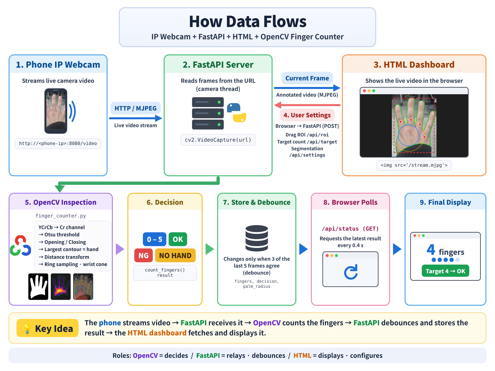
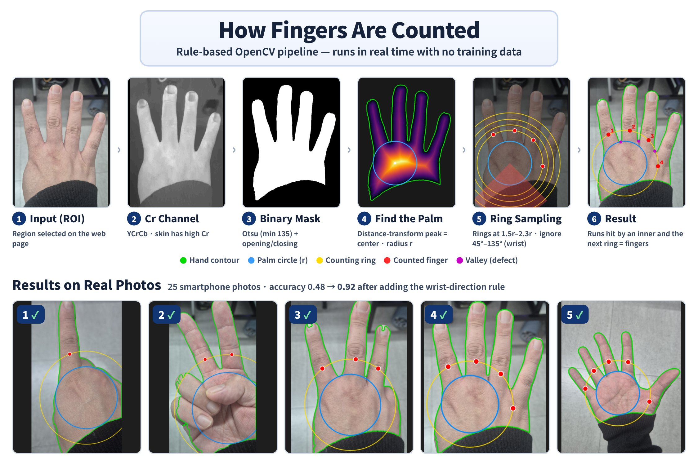

<div align="center">

# Finger Counter

**A real-time OpenCV web inspector that counts raised fingers (0–5) from a smartphone camera stream**

[](https://www.python.org/)
[](https://opencv.org/)
[](https://fastapi.tiangolo.com/)
[](#quality-assurance)
[](#evaluation)

[한국어](README.md) · **English**


<sub>The dashboard UI is in Korean; the diagrams below are in English.</sub>

</div>

## At a Glance

| | |
|---|---|
| **What** | Counts the fingers in a live smartphone (IP Webcam) stream and judges **OK / NG** against a target count |
| **How** | A **rule-based OpenCV pipeline** with no training data — skin segmentation, contours, distance transform, ring sampling |
| **Results** | **Accuracy 0.48 → 0.92** on 25 real smartphone photos |
| **Quality** | 41 automated tests, a regression test that reproduces a real bug, and a fake IP Webcam for camera-free testing |
| **Context** | A mini project extending the "web-based bottle-cap inspection" lab from a Vision AI training program |

<details>
<summary><b>Compared with the bottle-cap lab</b></summary>

The project keeps the same real-time architecture (IP Webcam → FastAPI → OpenCV → web) but extends the task to **counting** parts of an object whose shape changes every frame — a hand.

| | Bottle-cap lab | Finger Counter |
|---|---|---|
| Segmentation | Gray → Otsu | **Cr channel of YCrCb** → Otsu (skin, robust to lighting) |
| Feature | One area ratio of the largest contour | Palm center & radius (**distance transform**) + **ring sampling** |
| Threshold | Midpoint of two reference images | No reference images (rules relative to palm size) |
| Output | OK / NG | **0–5**, plus OK / NG when a target count is set |
| Debouncing | None | Result changes only when 3 of the last 5 frames agree |

</details>

## Architecture



- **A single camera thread** reads and inspects frames, so any number of browser tabs share one camera connection.
- Video (`/stream.mjpg`) and state (`/api/status`, every 0.4 s) are fetched separately, so the status panel survives a stalled stream.
- When a setting changes, the in-flight frame's result is discarded so **results from old settings never leak through**.

## Algorithm



Rings are drawn around the palm center, and **each run where the hand crosses a ring is one finger**. Every rule is relative to the palm radius *r*, so the same logic works whether the hand is near or far.

<details>
<summary><b>Step-by-step details and design rationale</b></summary>

| Step | Operation | Why |
|---|---|---|
| ①&nbsp;Segment | BGR → YCrCb, **Otsu on Cr** (floor of 135) | Skin has high Cr regardless of brightness. The floor stops Otsu from splitting the background when no hand is present |
| ②&nbsp;Clean | Opening → closing, kernel scaled to image size | Same behavior at any resolution |
| ③&nbsp;Hand | Largest external contour = hand | Drops small skin-colored noise |
| ④&nbsp;Palm | **Distance-transform peak** = palm center, its value = radius *r* | Fingers and wrist are thinner than the palm, so the peak lands on the palm |
| ⑤&nbsp;Rings | Find **contiguous on-hand runs** along rings at 1.5r, 1.75r, 2.0r, 2.3r (360 samples each) | Each run = one finger crossing the ring |
| ⑥&nbsp;Filter | Keep runs hit by **two neighboring rings in the same direction (±15°)**; ignore runs pointing **down 45°–135° (wrist)** | Rejects folded knuckles (too short) and a sleeve-cut wrist (wrong direction) |

**Convexity defects** (valleys between fingers + 1) are computed as a second opinion and shown on the dashboard. With zero valleys they cannot tell 0 from 1, so the final count comes from ring sampling.

</details>

## Evaluation

| Dataset | Images | Accuracy | 1 | 2 | 3 | 4 | 5 |
|---|---|---|---|---|---|---|---|
| Real smartphone photos (before) | 25 | 0.48 | 3/5 | 3/5 | 2/5 | 2/5 | 2/5 |
| **Real smartphone photos (after)** | 25 | **0.92** | 5/5 | 4/5 | 4/5 | 5/5 | 5/5 |
| Synthetic hands (0–5 × 5) | 30 | 1.00 | | | | | |

By reviewing the result images one by one, I found that **a sleeve-cut wrist was being counted as a finger**, and changed the wrist rule from width to direction — raising accuracy from 0.48 to 0.92.

<details>
<summary><b>Debugging story in detail</b></summary>

1. **Observe:** Segmentation masks were nearly perfect, yet counts were off by one in both directions. I reviewed all 25 result images and grouped the failures.
2. **Causes:**
   - A black sleeve cut the wrist diagonally, leaving a **narrow strip** that passed the old "wrist = wide run" rule and was counted as a finger.
   - The sleeve also hid the lower palm, so the **palm radius was underestimated** and the thumb or pinky was discarded as wrist.
3. **Fix:** Identify the wrist by **direction, not width** (runs pointing 45°–135° below the palm center) and relax the width cap to 2.0r.
4. **Prevent regressions:** Added a regression test that reproduces the bug and confirmed it fails on the old code.

The two remaining errors are a tilted hand whose palm edge looks like a finger and a hand so close that the fingers are cropped. I stopped tuning here to avoid overfitting 25 photos.

</details>

## Quality Assurance

41 automated tests (pytest) cover the core logic and the server API, and a regression test that reproduces a real bug keeps it from coming back.

<details>
<summary><b>Test coverage and commands</b></summary>

```bash
python -m pytest -q               # 41 passed
python -m src.finger_batch_test   # accuracy with folder names (1–5) as labels → CSV report
```

| Area | What is verified |
|---|---|
| Core logic | Synthetic hands 0–5 × 5 shot conditions (position, scale, tilt, brightness), no hand, cropped input, light-background mode, invalid input |
| Regression | A sleeve-cut wrist strip is not counted as a finger (reproduces a real bug) |
| Server API | Page and static files, target OK/NG flow, 3-of-5 debouncing, input validation (ROI size, target range, private IPs only), result reset on setting change |
| Camera-free | `process_frame()` is decoupled from the camera thread, so server behavior is tested with single images |
| Manual | `fake_ipwebcam.py` streams an image folder as MJPEG, exactly like the IP Webcam app |

</details>

## Getting Started

<details>
<summary><b>Install and run (smartphone IP Webcam)</b></summary>

```bash
git clone https://github.com/yonghoonchoi88/finger_counter.git && cd finger_counter
python3 -m venv .venv && source .venv/bin/activate   # Windows: .venv\Scripts\activate
pip install -r requirements.txt
uvicorn src.fastapi_finger_app:app --host 0.0.0.0 --port 8000 --timeout-graceful-shutdown 2
```

1. Start the server in the IP Webcam app (phone and PC on the same Wi-Fi).
2. Open `http://localhost:8000`, enter the stream URL (e.g. `http://192.168.0.25:8080/video`), and click **카메라 연결** (Connect).
3. Drag an ROI around the whole hand. Pick a target count to switch to OK/NG.

</details>

<details>
<summary><b>Run without a smartphone · measure accuracy</b></summary>

```bash
python -m src.make_demo_hands                              # generate 30 synthetic hands
python -m src.fake_ipwebcam                                # terminal 1 → http://127.0.0.1:8081/video
uvicorn src.fastapi_finger_app:app --port 8000             # terminal 2

python -m src.finger_batch_test                            # real photos in samples/1–5
python -m src.finger_batch_test --dir samples/fingers_demo # synthetic hands
```

Outputs: `reports/finger_batch_results.csv`, `outputs/finger_batch/*_result.jpg`

</details>


<details>
<summary><b>Project structure</b></summary>

```
finger_counter/
├── src/
│   ├── finger_counter.py       # core algorithm (segmentation · contour · distance transform · ring sampling)
│   ├── fastapi_finger_app.py   # real-time server (camera thread · debouncing · REST API · MJPEG)
│   ├── finger_batch_test.py    # folder-level accuracy measurement · CSV report
│   ├── make_demo_hands.py      # synthetic hand generator
│   └── fake_ipwebcam.py        # fake IP Webcam for testing (MJPEG)
├── web/
│   ├── finger_inspection.html  # dashboard (video · result · settings · how it works)
│   └── static/                 # app.js · style.css
├── tests/test_finger_counter.py
├── samples/1~5/                # real hand photos (label = folder name)
└── docs/images/                # demo GIF · architecture · pipeline (Korean / English)
```

</details>

<details>
<summary><b>REST API</b></summary>

| Method | Path | Description |
|---|---|---|
| `GET` | `/` | Dashboard |
| `GET` | `/stream.mjpg` | Live annotated video (MJPEG) |
| `GET` | `/api/status` | Camera state · finger count · decision · details |
| `POST` | `/api/camera` | Connect an IP Webcam URL (private IPs, http(s) only) |
| `POST` / `DELETE` | `/api/roi` | Set / clear the inspection region (normalized 0–1 coordinates) |
| `POST` | `/api/target` | Target finger count (0–5, `null` to clear) |
| `POST` | `/api/settings` | Segmentation mode `skin` · `dark_bg` · `light_bg`, mask preview |

</details>

## Limitations & Next Steps

Fingers held together may count as one, a hand lying sideways breaks the downward-wrist rule, and a face or arm larger than the hand inside the ROI can be mistaken for the hand.

<details>
<summary><b>Next steps</b></summary>

- [ ] Expand the test set with fist (0) photos and other places and lighting (currently one location, 1–5 × 5)
- [ ] Estimate the wrist direction from the hand's principal axis (PCA) instead of assuming "down"
- [ ] Benchmark against MediaPipe Hands (21 keypoints) on the same test set — accuracy and latency
- [ ] Train a lightweight CNN on collected photos with this rule-based model as the baseline
- [ ] Run pytest and the batch test on every push with GitHub Actions

</details>

---

<div align="center">

**Yonghoon Choi** · [@yonghoonchoi88](https://github.com/yonghoonchoi88)<br>
5+ years in software QA & test automation, moving into Vision AI · mini project from a Vision AI & industrial vertical-AI training program

</div>
