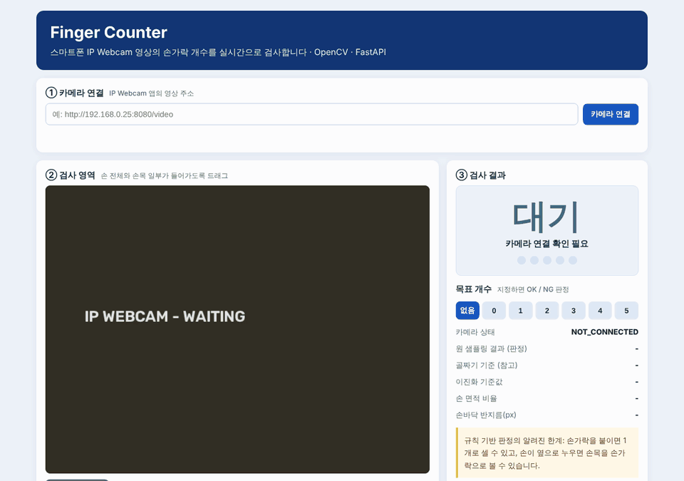
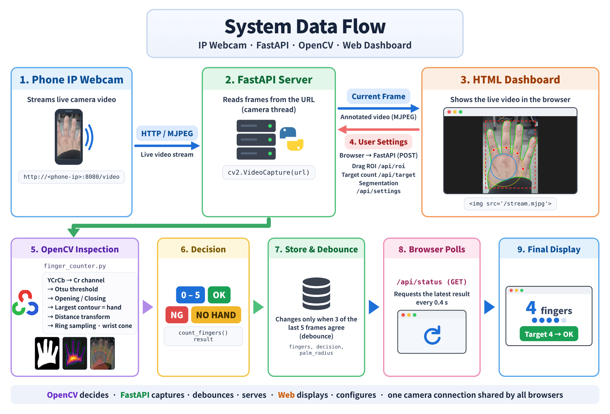

<div align="center">

# Finger Counter <sub><sup>[한국어](README.md) · **English**</sup></sub>

A real-time vision inspector that counts raised fingers (0–5) in a smartphone camera stream

[](https://www.python.org/)
[](https://opencv.org/)
[](https://fastapi.tiangolo.com/)
[](#tests)
[](#results)



<sub>The dashboard UI is in Korean.</sub>

</div>

## Overview

A rule-based vision inspector that applies production-line part counting to an object whose shape changes every frame — a hand.

<details>
<summary>Details</summary>

Production-line inspection often asks one question: *are there as many as there should be?* This project applies that question to a hand, an object whose shape changes every frame. Like a part-count or missing-part check, it counts, compares against a target, and returns OK or NG. Unlike a fixed part, position, scale, angle and lighting all vary.

I chose a rule-based pipeline over a learned model for three reasons:

- It can be validated on site immediately, without a labeled dataset.
- Every decision is drawn on the video (palm circle, counted runs), so a wrong count can be traced to its cause on the spot.
- It runs in real time on a CPU.

It also serves as the baseline for any learned model introduced later.

</details>

## Features

Live MJPEG input, 0–5 counting with OK/NG, debouncing, decision overlay, offline evaluation, camera simulator.

<details>
<summary>Details</summary>

- Live MJPEG input from the Android IP Webcam app, with an ROI drawn in the browser
- Finger count 0–5, plus OK / NG when a target count is set
- A count changes only when 3 of the last 5 frames agree, so the display does not flicker while the hand moves
- Binary mask and decision overlay on the video for on-site diagnosis
- Offline evaluation on labeled folders: accuracy, confusion matrix, per-image CSV
- An IP Webcam simulator that replays the full pipeline without a phone

</details>

## How it works


Rings are drawn around the palm, and **each place where the hand crosses a ring counts as one finger**.

<details>
<summary>Design rationale</summary>

After segmenting skin, a distance transform gives the palm center and radius *r*. Every threshold is relative to *r*, so the same rules hold whether the hand is near or far.

| Step | Operation | Rationale |
|---|---|---|
| Skin segmentation | YCrCb, Otsu on Cr with a floor of 135 | Cr on skin barely changes with brightness. The floor stops Otsu from splitting an empty background into a phantom hand |
| Cleanup | Opening → closing, kernel scaled to image size | Same settings from 480p video to full-size photos |
| Hand | Largest external contour | Drops small skin-colored blobs |
| Palm | Distance-transform peak = center, its value = radius *r* | Fingers and wrist are thinner than the palm, so the peak lands on the palm |
| Ring sampling | Contiguous on-hand runs on rings at 1.5r, 1.75r, 2.0r, 2.3r (360 samples each) | One radius is not enough: small rings see fingers merged at the base, large rings miss the thumb and pinky |
| Filtering | Keep runs that hit two neighboring rings in the same direction (±15°); runs pointing down 45°–135° are the wrist | Folded knuckles only reach the inner ring; a sleeve-cut wrist is told apart by direction, not width |

Convexity defects (valleys between fingers + 1) are computed and shown on the dashboard as well. A fist and a single finger both have zero valleys, so they are not used for the final count.

</details>

## Architecture



One camera thread captures and inspects frames; the browser fetches video and state separately.

<details>
<summary>Design notes</summary>

- A single background thread owns the camera. However many browser tabs are open, there is one camera connection.
- Video (`/stream.mjpg`) and state (`/api/status`, every 0.4 s) are separate, so decisions keep updating even if the video stalls.
- If the ROI or segmentation mode changes mid-frame, that frame's result is dropped so results from the old settings never mix with the new ones.

</details>

## Results

| Dataset | Images | Accuracy | 1 | 2 | 3 | 4 | 5 |
|---|---:|---:|---:|---:|---:|---:|---:|
| Real smartphone photos, before | 25 | 0.48 | 3/5 | 3/5 | 2/5 | 2/5 | 2/5 |
| **Real smartphone photos, after** | 25 | **0.92** | 5/5 | 4/5 | 4/5 | 5/5 | 5/5 |
| Synthetic hands (0–5 × 5) | 30 | 1.00 | | | | | |

<details>
<summary>Failure analysis and scope</summary>

Going through the misclassified photos showed that skin segmentation was nearly perfect; the wrist rule was the problem. A black sleeve cut the wrist diagonally and left a finger-sized strip that passed the "wide run = wrist" rule. Telling the wrist apart by **direction** instead of width raised accuracy from 0.48 to 0.92.

1. **Symptom**: Masks looked correct, yet counts were one too many (1→2, 2→3, 4→5) or too few (5→3).
2. **Cause A**: The sleeve cut the wrist diagonally, leaving a narrow strip below the palm. The old rule filtered the wrist mainly by width (> 0.95r), so the strip was counted as a finger.
3. **Cause B**: The sleeve also hid the lower palm, so *r* was underestimated. Real fingers then measured 1.0–1.6r and the thumb or pinky was rejected as wrist.
4. **Fix**: Treat runs pointing 45°–135° below the palm center as the wrist, and relax the width cap to 2.0r.
5. **Regression guard**: Reproduced the case with a synthetic image as a test and confirmed it fails on the old code.

Of the two remaining errors, one is a tilted hand whose palm edge looks like a finger, and the other is a hand so close that the fingers leave the frame. Tuning thresholds further on these 25 photos would risk overfitting, so I stopped here.

These are 25 photos of one person's hand in one place, so they do not measure generalization. Widening the test set across lighting, backgrounds and people is the next validation step.

</details>

## Quick start

```bash
git clone https://github.com/yonghoonchoi88/finger_counter.git && cd finger_counter
pip install -r requirements.txt
uvicorn src.fastapi_finger_app:app --host 0.0.0.0 --port 8000 --timeout-graceful-shutdown 2
```

<details>
<summary>Usage · run without a phone · offline evaluation</summary>

Open `http://localhost:8000`, connect the IP Webcam stream (e.g. `http://192.168.0.25:8080/video`), and drag an inspection region around the hand.

```bash
python -m src.make_demo_hands                    # generate 30 synthetic hands
python -m src.ipwebcam_simulator                 # terminal 1: http://127.0.0.1:8081/video
uvicorn src.fastapi_finger_app:app --port 8000   # terminal 2

python -m src.finger_batch_test                            # real photos in samples/1–5
python -m src.finger_batch_test --dir samples/fingers_demo # synthetic hands
```

Results go to `reports/finger_batch_results.csv` and `outputs/finger_batch/`, and a confusion matrix is printed to the terminal.

</details>

## Tests

`python -m pytest -q` — 41 tests covering the pipeline, a regression case and the server API.

<details>
<summary>Coverage</summary>

Frame processing lives in `process_frame()`, separate from the camera thread, so even server behavior is verified with single images.

| Area | What is covered |
|---|---|
| Pipeline | Synthetic hands 0–5 × 5 shot conditions (position, scale, tilt, exposure), no hand, cropped input, light-background mode, invalid input |
| Regression | A sleeve-cut wrist strip is not counted as a finger (Cause A above) |
| Server | Page and static files, target OK/NG, 3-of-5 debouncing, input validation (ROI size, target range, private IPs only), reset on setting change |
| Simulator | `ipwebcam_simulator.py` streams an image folder as the same MJPEG the app produces, so the full path can be replayed with identical input |

</details>

## Limitations and roadmap

Fingers held together, a hand lying sideways, or other skin inside the ROI can cause miscounts.

<details>
<summary>Details</summary>

Fingers held together may count as one, and a hand lying sideways breaks the "down = wrist" assumption. A face or arm larger than the hand inside the ROI can be mistaken for the hand.

- [ ] Extend the test set with fists (0) and other places, lighting and people
- [ ] Estimate wrist direction from the hand's principal axis (PCA) instead of assuming "down"
- [ ] Compare accuracy and latency with MediaPipe Hands on the same test set
- [ ] Train a lightweight classifier on collected photos, using this pipeline as the baseline
- [ ] Run tests and offline evaluation on every push with GitHub Actions

</details>

## Reference

<details>
<summary>Project structure</summary>

```
finger_counter/
├── src/
│   ├── finger_counter.py       # detection pipeline
│   ├── fastapi_finger_app.py   # live server (camera thread, debouncing, REST API, MJPEG)
│   ├── finger_batch_test.py    # offline evaluation
│   ├── make_demo_hands.py      # synthetic hand generator
│   └── ipwebcam_simulator.py   # IP Webcam simulator
├── web/                        # dashboard (HTML, JS, CSS)
├── tests/
├── samples/1–5/                # real hand photos, folder name = label
└── images/                     # figures for the README and dashboard
```

</details>

<details>
<summary>REST API</summary>

| Method | Path | Description |
|---|---|---|
| `GET` | `/` | Dashboard |
| `GET` | `/stream.mjpg` | Live annotated video |
| `GET` | `/api/status` | Camera state, finger count, decision, details |
| `POST` | `/api/camera` | Connect an IP Webcam URL (private IPs, http(s) only) |
| `POST` `DELETE` | `/api/roi` | Set / clear the inspection region (normalized 0–1) |
| `POST` | `/api/target` | Target count 0–5, `null` to clear |
| `POST` | `/api/settings` | Segmentation mode `skin` `dark_bg` `light_bg`, mask preview |

</details>

---

<div align="center">
<sub>Yonghoon Choi · <a href="https://github.com/yonghoonchoi88">@yonghoonchoi88</a> · QA / Test Automation → Vision AI</sub>
</div>
