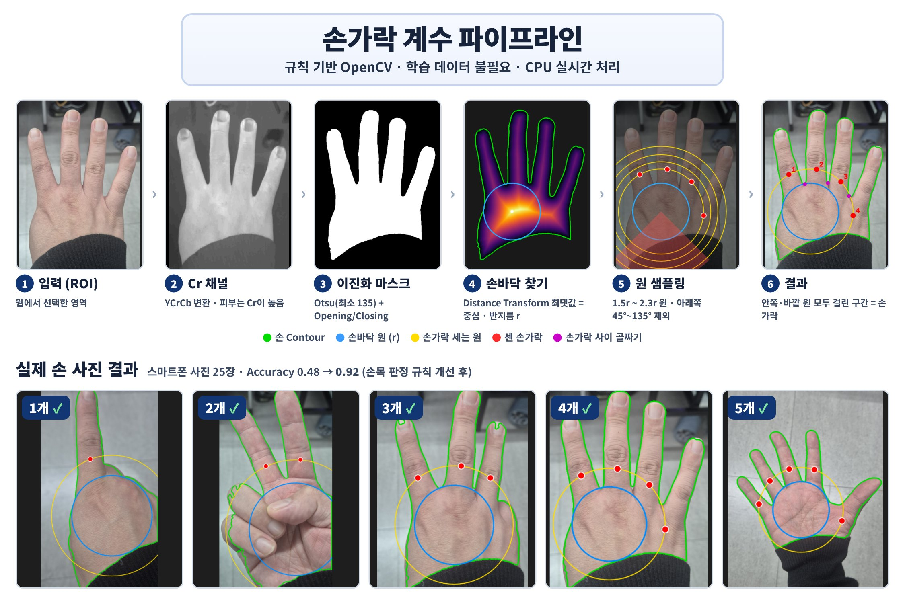

<div align="center">

# Finger Counter <sub><sup>**한국어** · [English](README.en.md)</sup></sub>

스마트폰 카메라 영상에서 펴고 있는 손가락 수(0–5)를 실시간으로 세는 비전 검사 시스템

[](https://www.python.org/)
[](https://opencv.org/)
[](https://fastapi.tiangolo.com/)
[](#테스트)
[](#성능)


</div>

## 개요

생산 라인의 수량·누락 검사 문제를 프레임마다 모양이 바뀌는 대상(손)에 적용한 규칙 기반 비전 검사입니다.

<details>
<summary>자세히</summary>

생산 라인 검사에서 자주 나오는 "기준 개수만큼 있는가" 문제를, 프레임마다 모양이 바뀌는 대상인 손에 적용했습니다. 부품 수량 확인이나 누락 검사처럼 개수를 세어 기준과 비교하고 OK/NG를 냅니다. 대상이 정형화되어 있지 않아 위치·크기·각도·조명이 모두 흔들린다는 점이 일반적인 부품 검사보다 까다롭습니다.

학습 모델 대신 규칙 기반을 선택한 이유는 세 가지입니다.

- 라벨링 데이터 없이 바로 현장 조건에서 검증할 수 있습니다.
- 판정 근거(손바닥 원, 센 구간)를 영상 위에 그대로 그려 오판 원인을 바로 추적할 수 있습니다.
- GPU 없이 CPU만으로 실시간 처리됩니다.

이 결과는 이후 학습 모델을 도입할 때 비교할 기준선(baseline) 역할도 합니다.

</details>

## 주요 기능

실시간 MJPEG 입력, 0–5개 판정과 OK/NG, 결과 안정화, 판정 근거 시각화, 오프라인 평가, 카메라 시뮬레이터.

<details>
<summary>자세히</summary>

- 스마트폰 IP Webcam의 MJPEG 영상을 실시간으로 받아 브라우저에서 검사 영역(ROI) 지정
- 손가락 수 0–5 판정, 목표 개수를 지정하면 OK / NG 판정
- 최근 5프레임 중 3프레임이 일치할 때만 결과를 바꿔 손을 움직이는 동안의 깜빡임 제거
- 이진화 마스크와 판정 근거를 영상에 겹쳐 표시해 현장에서 바로 원인 확인
- 라벨 폴더 기반 오프라인 평가: 정확도, 혼동 행렬, 이미지별 CSV
- 스마트폰 없이 전체 흐름을 재현하는 IP Webcam 시뮬레이터

</details>

## 동작 원리



손바닥 둘레에 원을 그려 **손이 원을 가로지르는 구간의 수**를 손가락 수로 셉니다.

<details>
<summary>단계별 설계 근거</summary>

피부 영역을 분리한 뒤 Distance Transform으로 손바닥 중심과 반지름 r을 구합니다. 모든 기준을 r에 대한 비율로 정했기 때문에 손이 카메라에서 멀든 가깝든 같은 규칙이 적용됩니다.

| 단계 | 처리 | 근거 |
|---|---|---|
| 피부 분리 | YCrCb 변환 후 Cr 채널에 Otsu, 기준값 하한 135 | 피부의 Cr 값은 밝기와 거의 무관해 조명 변화에 강함. 손이 없을 때 Otsu가 배경을 억지로 둘로 나누지 않도록 하한을 둠 |
| 노이즈 정리 | Opening → Closing, 커널 크기는 이미지 크기에 비례 | 480p부터 원본 사진까지 같은 설정으로 동작 |
| 손 검출 | 가장 큰 외곽 Contour | 작은 피부색 잡음 제거 |
| 손바닥 | Distance Transform 최댓값 = 중심, 그 값 = 반지름 r | 손가락과 손목은 손바닥보다 가늘어 최댓값이 손바닥에 잡힘 |
| 원 샘플링 | 1.5r, 1.75r, 2.0r, 2.3r 원 위 360점에서 손 위에 있는 연속 구간 검출 | 반지름 하나로는 부족함. 작으면 손가락 뿌리가 붙어 보이고, 크면 엄지·새끼가 닿지 않음 |
| 필터 | 이웃한 두 원에 같은 방향(±15°)으로 모두 걸린 구간만 인정, 아래쪽 45°–135°는 손목으로 제외 | 접힌 손가락 마디는 안쪽 원에만 걸리고, 소매에 잘린 손목은 폭이 아니라 방향으로 구분됨 |

Convexity Defects(손가락 사이 골짜기 수 + 1)도 함께 계산해 대시보드에 표시합니다. 주먹과 손가락 1개는 둘 다 골짜기가 0개라 구분할 수 없으므로 최종 판정에는 쓰지 않습니다.

</details>

## 시스템 구조


카메라 스레드 1개가 영상을 받아 판정하고, 브라우저는 영상과 상태를 따로 받습니다.

<details>
<summary>설계 포인트</summary>

- 카메라는 서버의 백그라운드 스레드 하나가 전담합니다. 브라우저 탭이 몇 개 열려 있어도 카메라 연결은 하나입니다.
- 영상(`/stream.mjpg`)과 상태(`/api/status`, 0.4초 주기)를 분리해, 영상이 잠시 끊겨도 판정 정보는 계속 갱신됩니다.
- 처리 도중 ROI나 이진화 방식이 바뀌면 그 프레임의 결과는 버립니다. 이전 설정의 결과가 새 설정에 섞이지 않게 하기 위해서입니다.

</details>

## 성능

| 데이터 | 장수 | Accuracy | 1 | 2 | 3 | 4 | 5 |
|---|---:|---:|---:|---:|---:|---:|---:|
| 실제 스마트폰 사진, 개선 전 | 25 | 0.48 | 3/5 | 3/5 | 2/5 | 2/5 | 2/5 |
| **실제 스마트폰 사진, 개선 후** | 25 | **0.92** | 5/5 | 4/5 | 4/5 | 5/5 | 5/5 |
| 합성 손 이미지 (0–5 × 5) | 30 | 1.00 | | | | | |

<details>
<summary>오류 분석과 검증 범위</summary>

오판 사진을 하나씩 확인해 보니 피부 분리는 거의 완벽했고, 문제는 손목 판정이었습니다. 검은 소매가 손목을 비스듬히 자르면서 손가락만 한 띠가 생겼고, 이것이 "폭이 넓으면 손목"이라는 규칙을 통과했습니다. 손목을 폭이 아닌 **방향**으로 구분하도록 바꿔 0.48에서 0.92로 올렸습니다.

1. **증상**: 이진화 마스크는 정상인데 개수가 1→2, 2→3, 4→5처럼 하나 많거나, 5→3처럼 적게 나옴.
2. **원인 A**: 소매가 손목을 비스듬히 잘라 손바닥 왼쪽 아래에 좁은 띠가 생김. 기존 규칙은 손목을 주로 폭(0.95r 초과)으로 걸러서 이 띠가 손가락으로 세어짐.
3. **원인 B**: 소매가 손바닥 아래쪽까지 가려 반지름 r이 작게 측정됨. 실제 손가락 폭이 상대적으로 1.0–1.6r로 커져, 엄지·새끼가 손목 기준에 걸려 빠짐.
4. **수정**: 손바닥 중심 기준 아래쪽 45°–135° 구간을 손목으로 보고, 폭 상한은 2.0r로 완화.
5. **재발 방지**: 같은 상황을 합성 이미지로 재현한 회귀 테스트를 추가하고, 수정 전 코드에서 실패하는 것을 확인.

남은 오답 2건 중 하나는 손을 기울여 손바닥 옆면이 손가락처럼 잡힌 경우, 다른 하나는 손이 너무 가까워 손가락이 화면 밖으로 잘린 경우입니다. 이 25장에 기준값을 더 맞추면 과적합이 될 수 있어 여기서 멈췄습니다.

단, 한 장소에서 한 사람의 손을 찍은 25장 기준이므로 일반화 성능으로 보기는 어렵습니다. 다른 조명·배경·사람으로 테스트셋을 넓히는 것이 다음 검증 과제입니다.

</details>

## 빠른 시작

```bash
git clone https://github.com/yonghoonchoi88/finger_counter.git && cd finger_counter
pip install -r requirements.txt
uvicorn src.fastapi_finger_app:app --host 0.0.0.0 --port 8000 --timeout-graceful-shutdown 2
```

<details>
<summary>사용 방법 · 스마트폰 없이 실행 · 오프라인 평가</summary>

브라우저에서 `http://localhost:8000`을 열고 스마트폰 IP Webcam 앱의 주소(예: `http://192.168.0.25:8080/video`)를 연결한 뒤, 손이 들어가도록 검사 영역을 드래그합니다.

```bash
python -m src.make_demo_hands                    # 합성 손 이미지 30장 생성
python -m src.ipwebcam_simulator                 # 터미널 1: http://127.0.0.1:8081/video
uvicorn src.fastapi_finger_app:app --port 8000   # 터미널 2

python -m src.finger_batch_test                            # samples/1–5 실제 사진
python -m src.finger_batch_test --dir samples/fingers_demo # 합성 손
```

평가 결과는 `reports/finger_batch_results.csv`와 `outputs/finger_batch/`에 저장되며, 터미널에 혼동 행렬이 출력됩니다.

</details>

## 테스트

`python -m pytest -q` — 파이프라인, 회귀, 서버 API를 포함한 41개 테스트.

<details>
<summary>테스트 구성</summary>

카메라 처리를 `process_frame()`으로 분리해 두어 서버 동작까지 이미지 한 장으로 검증합니다.

| 구분 | 내용 |
|---|---|
| 파이프라인 | 합성 손 0–5개 × 촬영 조건 5종(위치·크기·기울기·노출), 손 없음, 잘라낸 입력, 밝은 배경 모드, 잘못된 입력 |
| 회귀 | 소매에 잘린 손목 띠를 손가락으로 세지 않음 (오류 분석의 원인 A) |
| 서버 | 페이지·정적 파일, 목표 개수 OK/NG, 5프레임 중 3프레임 안정화, 입력 검증(ROI 크기·목표 범위·사설 IP만 허용), 설정 변경 시 결과 초기화 |
| 시뮬레이터 | `ipwebcam_simulator.py`가 이미지 폴더를 실제 앱과 같은 MJPEG로 송출해 전체 흐름을 같은 입력으로 반복 재현 |

</details>

## 한계와 향후 계획

붙인 손가락, 옆으로 누운 손, ROI 안의 다른 피부 영역에서 오판할 수 있습니다.

<details>
<summary>자세히</summary>

손가락을 붙이면 하나로 세어질 수 있고, 손이 옆으로 누우면 "아래쪽 = 손목" 가정이 깨집니다. 얼굴이나 팔이 ROI 안에서 손보다 크게 잡히면 손으로 오인할 수 있습니다.

- [ ] 주먹(0개)과 다른 장소·조명·사람의 사진으로 테스트셋 확장
- [ ] 손목 방향을 고정값 대신 손의 주축(PCA)으로 추정해 기울어진 손 대응
- [ ] MediaPipe Hands와 같은 테스트셋으로 정확도·처리 시간 비교
- [ ] 수집한 사진으로 경량 분류 모델을 학습하고 이 규칙 기반 결과를 기준선으로 비교
- [ ] GitHub Actions에서 push마다 테스트와 오프라인 평가 실행

</details>

## 참고

<details>
<summary>프로젝트 구조</summary>

```
finger_counter/
├── src/
│   ├── finger_counter.py       # 검출 파이프라인
│   ├── fastapi_finger_app.py   # 실시간 서버 (카메라 스레드, 안정화, REST API, MJPEG)
│   ├── finger_batch_test.py    # 오프라인 평가
│   ├── make_demo_hands.py      # 합성 손 이미지 생성
│   └── ipwebcam_simulator.py   # IP Webcam 시뮬레이터
├── web/                        # 대시보드 (HTML, JS, CSS)
├── tests/
├── samples/1–5/                # 실제 손 사진, 폴더 이름 = 정답
└── images/                     # README·대시보드용 그림
```

</details>

<details>
<summary>REST API</summary>

| Method | Path | 설명 |
|---|---|---|
| `GET` | `/` | 대시보드 |
| `GET` | `/stream.mjpg` | 판정 결과를 그린 실시간 영상 |
| `GET` | `/api/status` | 카메라 상태, 손가락 수, 판정, 세부 수치 |
| `POST` | `/api/camera` | IP Webcam 주소 연결 (사설 IP, http(s)만 허용) |
| `POST` `DELETE` | `/api/roi` | 검사 영역 설정 / 해제 (0–1 정규화 좌표) |
| `POST` | `/api/target` | 목표 개수 0–5, `null`이면 해제 |
| `POST` | `/api/settings` | 이진화 방식 `skin` `dark_bg` `light_bg`, 마스크 표시 여부 |

</details>

---

<div align="center">
<sub>Yonghoon Choi · <a href="https://github.com/yonghoonchoi88">@yonghoonchoi88</a> · QA / Test Automation → Vision AI</sub>
</div>
