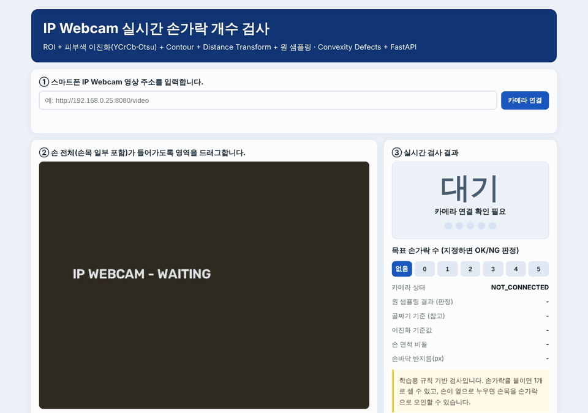
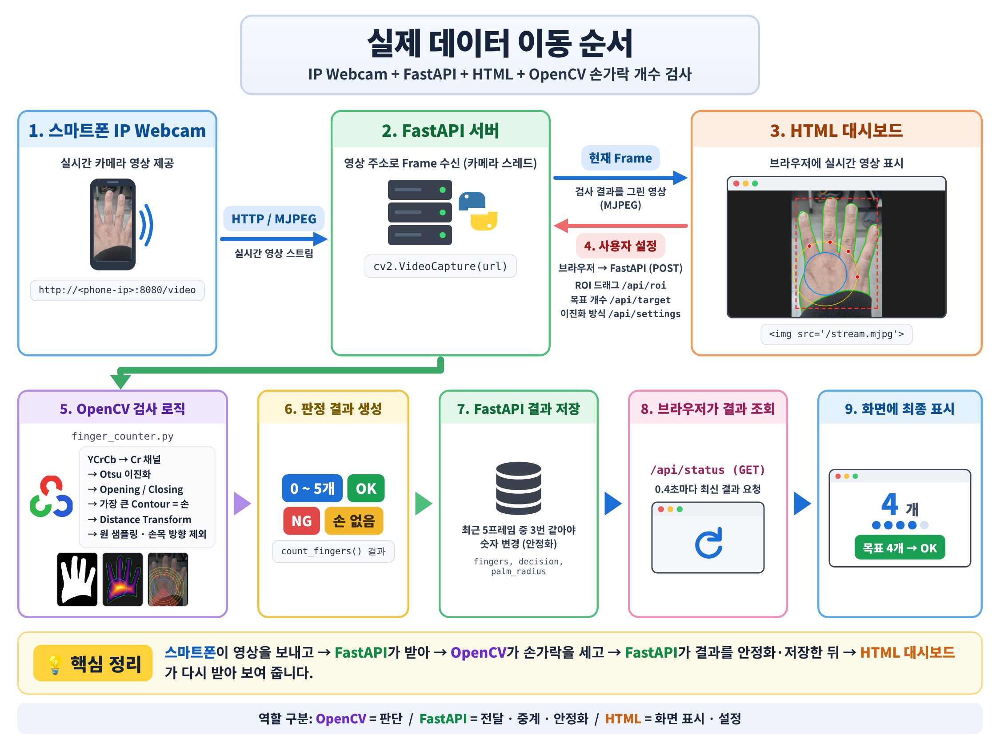

<div align="center">

# ✋ Finger Counter

**스마트폰 카메라 영상에서 펴고 있는 손가락 개수(0~5)를 실시간으로 세는 OpenCV 웹 검사 시스템**

[](https://www.python.org/)
[](https://opencv.org/)
[](https://fastapi.tiangolo.com/)
[](#-품질-관리)
[](#-성능-평가)

**한국어** · [English](README.en.md)



</div>

## 📌 한눈에 보기

| | |
|---|---|
| **무엇을** | 스마트폰(IP Webcam) 영상 속 손의 손가락 개수를 실시간으로 세고, 목표 개수와 비교해 **OK / NG** 판정 |
| **어떻게** | 학습 데이터 없이 **규칙 기반 OpenCV 파이프라인** — 피부색 이진화 · Contour · Distance Transform · 원 샘플링 |
| **결과** | 실제 스마트폰 사진 25장 **Accuracy 0.48 → 0.92**, 가상 손 30장 1.00 |
| **품질** | 자동 테스트 41개(pytest), 버그 재현 회귀 테스트, 카메라 없이 돌리는 가짜 IP Webcam |
| **배경** | 비솔 Vision AI 교육과정 머신비전 실습 *「웹 실행 병뚜껑 검사」* 를 응용한 미니 프로젝트 |

## 🧭 프로젝트 배경

수업에서는 병뚜껑 유무를 **면적 비율 하나**로 OK/NG 판정했습니다. 같은 실시간 구조(IP Webcam → FastAPI → OpenCV → 웹)를 유지하면서,
**모양이 매번 달라지는 대상(손)** 에서 **개수**를 세도록 문제를 확장했습니다.

| | 병뚜껑 검사 (수업) | 손가락 검사 (이 프로젝트) |
|---|---|---|
| 이진화 | Gray → Otsu | **YCrCb의 Cr 채널** → Otsu (피부색, 조명에 강함) |
| 특징 | 가장 큰 Contour의 Area Ratio 1개 | 손바닥 중심·반지름(**Distance Transform**) + **원 샘플링** |
| 기준값 | 기준 이미지 2장의 중간값 | 기준 이미지 없음 (손바닥 크기 대비 비율 규칙) |
| 출력 | OK / NG | **0~5개** + 목표 개수 지정 시 OK / NG |
| 실시간 안정화 | 없음 | 최근 5프레임 중 3번 일치해야 결과 변경 |

## 🏗️ 시스템 구조



- **카메라 스레드 1개**가 영상을 읽고 검사해 최신 결과를 보관합니다. 브라우저가 여러 개 열려도 카메라 연결은 하나입니다.
- 브라우저는 영상(`/stream.mjpg`)과 상태(`/api/status`, 0.4초 주기)를 **따로** 받아, 영상이 끊겨도 상태 표시는 유지됩니다.
- 설정(ROI · 목표 개수 · 이진화 방식)이 바뀌면 처리 중이던 프레임 결과는 버려서 **이전 설정의 결과가 섞이지 않게** 했습니다.

## 🔬 알고리즘


| 단계 | 처리 | 이렇게 한 이유 |
|---|---|---|
| ①&nbsp;이진화 | BGR → YCrCb, **Cr 채널에 Otsu** (기준값 최소 135) | 피부는 밝기(Y)와 무관하게 Cr이 높아 조명 변화에 강함. 손이 없을 때 Otsu가 배경을 억지로 나누지 않도록 하한을 둠 |
| ②&nbsp;정리 | Opening → Closing, 커널 크기는 이미지 크기에 비례 | 해상도가 달라도 같은 규칙이 적용되도록 |
| ③&nbsp;손&nbsp;찾기 | 가장 큰 외곽 Contour = 손 | 작은 피부색 잡음 제거 |
| ④&nbsp;손바닥 | **Distance Transform 최댓값** = 손바닥 중심, 그 값 = 반지름 r | 손가락·손목은 손바닥보다 가늘어서 중심이 자연스럽게 손바닥에 잡힘. 이후 모든 기준을 r 대비 비율로 표현 → 거리·크기 무관 |
| ⑤&nbsp;원&nbsp;샘플링 | 1.5r · 1.75r · 2.0r · 2.3r 원 위 360점에서 손 위에 있는 **연속 구간** 검출 | 구간 하나 = 원을 가로지르는 손가락 하나 |
| ⑥&nbsp;필터 | 이웃한 두 원에 **같은 방향(±15°)으로 모두 걸린** 구간만 인정, **아래쪽 45°~135°는 손목**으로 제외 | 주먹의 접힌 마디(짧음)와 소매에 잘린 손목(방향)을 걸러냄 |

참고값으로 **Convexity Defects**(손가락 사이 골짜기 수 + 1)도 함께 계산해 화면에 보여 줍니다. 골짜기가 0개면 0개와 1개를 구분할 수 없어서 최종 판정에는 원 샘플링을 씁니다.

## 📊 성능 평가

`python -m src.finger_batch_test` — 폴더 이름(1~5)을 정답으로 사진 전체를 검사합니다.

| 데이터 | 장수 | Accuracy | 1개 | 2개 | 3개 | 4개 | 5개 |
|---|---|---|---|---|---|---|---|
| 실제 스마트폰 사진 (개선 전) | 25 | 0.48 | 3/5 | 3/5 | 2/5 | 2/5 | 2/5 |
| **실제 스마트폰 사진 (개선 후)** | 25 | **0.92** | 5/5 | 4/5 | 4/5 | 5/5 | 5/5 |
| 가상 손 이미지 (0~5개 × 5) | 30 | 1.00 | | | | | |

### 문제 해결 과정 — 0.48 → 0.92

1. **관찰** — 이진화 마스크는 거의 완벽했는데, 개수가 한 개씩 많거나 적었습니다. 결과 이미지를 25장 모두 열어 원인을 분류했습니다.
2. **원인 ①** 검은 소매가 손목을 비스듬히 잘라 손바닥 아래에 **좁은 띠**가 생겼고, 기존 규칙(손목 = 폭이 넓은 구간)을 통과해 손가락으로 세어졌습니다. → 1→2, 2→3, 3→4, 4→5
3. **원인 ②** 소매가 손바닥 아래쪽을 가려 **손바닥 반지름이 작게 측정**되자, 실제 손가락 폭이 상대적으로 커져 엄지·새끼가 손목으로 빠졌습니다. → 5→3
4. **해결** — 손목을 **폭이 아니라 방향**(손바닥 중심에서 아래쪽 45°~135°)으로 구분하고, 폭 상한을 2.0r로 완화했습니다.
5. **재발 방지** — 같은 상황을 재현하는 테스트(`test_downward_strip_is_not_a_finger`)를 추가했고, 수정 전 코드에서 실패하는 것을 확인했습니다.

남은 오답 2장은 ① 손을 기울여 손바닥 옆면이 손가락처럼 잡힌 경우, ② 손이 카메라에 너무 가까워 손가락이 화면 밖으로 잘린 경우입니다.
25장에 과하게 맞추지 않기 위해 여기서 멈췄고, [다음 단계](#-한계와-다음-단계)에 정리했습니다.

## ✅ 품질 관리

```bash
python -m pytest -q        # 41 passed
```

| 구분 | 확인 내용 |
|---|---|
| 핵심 로직 | 가상 손 0~5개 × 촬영 조건 5가지(위치·크기·기울기·밝기), 손 없음, 잘라낸 이미지, 밝은 배경 모드, 잘못된 입력 |
| 회귀 테스트 | 소매에 잘린 손목 띠를 손가락으로 세지 않는지 (실제 버그 재현) |
| 서버 API | 화면·정적 파일, 목표 개수 OK/NG 흐름, 5프레임 중 3번 안정화, 입력값 검증(ROI 크기·목표 범위·사설 IP만 허용), 설정 변경 시 결과 초기화 |
| 카메라 없는 테스트 | `process_frame()`을 카메라 스레드와 분리해 이미지 한 장으로 서버 동작을 검증 |
| 수동 테스트 | `fake_ipwebcam.py` — 이미지 폴더를 IP Webcam과 같은 MJPEG로 송출 |

## 🚀 빠른 시작

```bash
git clone https://github.com/yonghoonchoi88/finger_counter.git
cd finger_counter
python3 -m venv .venv && source .venv/bin/activate   # Windows: .venv\Scripts\activate
pip install -r requirements.txt
```

**① 스마트폰으로 실시간 검사**

```bash
uvicorn src.fastapi_finger_app:app --host 0.0.0.0 --port 8000 --timeout-graceful-shutdown 2
```

1. 스마트폰 IP Webcam 앱에서 서버 시작 → PC와 같은 Wi-Fi
2. 브라우저 `http://localhost:8000` → 주소 입력 (예: `http://192.168.0.25:8080/video`) → **카메라 연결**
3. 손 전체가 들어가도록 ROI 드래그 → 손가락 개수 표시, 목표 개수를 누르면 OK/NG

**② 스마트폰 없이 실행 (가짜 카메라)**

```bash
python -m src.make_demo_hands                          # 가상 손 30장 생성
python -m src.fake_ipwebcam                            # 터미널 1 → http://127.0.0.1:8081/video
uvicorn src.fastapi_finger_app:app --port 8000         # 터미널 2
```

**③ 정확도 측정 (Batch Test)**

```bash
python -m src.finger_batch_test                            # samples/1~5 실제 사진
python -m src.finger_batch_test --dir samples/fingers_demo # 가상 손
```

결과: `reports/finger_batch_results.csv`, `outputs/finger_batch/*_result.jpg`

<details>
<summary><b>문제 해결 (자주 막히는 곳)</b></summary>

| 증상 | 해결 |
|---|---|
| `localhost:8000`이 계속 "로드 중" | 다른 프로그램이 8000번 사용 중 → `--port 8001` |
| `address already in use` | 이전 서버가 영상 연결 때문에 안 꺼짐 → `ss -ltnp \| grep 8001` 후 `kill -9 <PID>`, 다음부터 `--timeout-graceful-shutdown 2` |
| 카메라 연결 실패 | 주소 끝 `/video` 확인. 학교·회사 Wi-Fi는 기기 간 통신을 막는 경우가 많음 → 휴대폰 핫스팟 사용 |
| "손 없음" | 오른쪽 위 마스크 확인. 피부색과 비슷한 배경(나무 책상·베이지 벽) 피하기, 단색 배경이면 이진화 방식 변경 |

</details>

## 🗂️ 프로젝트 구조

```
finger_counter/
├── src/
│   ├── finger_counter.py       # 핵심 알고리즘 (이진화 · Contour · Distance Transform · 원 샘플링)
│   ├── fastapi_finger_app.py   # 실시간 서버 (카메라 스레드 · 안정화 · REST API · MJPEG)
│   ├── finger_batch_test.py    # 폴더 단위 정확도 측정 · CSV 보고서
│   ├── make_demo_hands.py      # 가상 손 이미지 생성기
│   └── fake_ipwebcam.py        # 테스트용 가짜 IP Webcam (MJPEG 송출)
├── web/
│   ├── finger_inspection.html  # 대시보드 (영상 · 결과 · 설정 · 동작 원리)
│   └── static/                 # app.js · style.css
├── tests/test_finger_counter.py
├── samples/1~5/                # 실제 손 사진 (정답 = 폴더 이름)
└── docs/images/                # 데모 GIF · 구조도 · 알고리즘 그림 (한국어/영어)
```

<details>
<summary><b>REST API</b></summary>

| Method | Path | 설명 |
|---|---|---|
| `GET` | `/` | 대시보드 |
| `GET` | `/stream.mjpg` | 검사 결과를 그린 실시간 영상 (MJPEG) |
| `GET` | `/api/status` | 카메라 상태 · 손가락 수 · 판정 · 세부 수치 |
| `POST` | `/api/camera` | IP Webcam 주소 연결 (사설 IP · http(s)만 허용) |
| `POST` / `DELETE` | `/api/roi` | 검사 영역 설정 / 해제 (0~1 비율 좌표) |
| `POST` | `/api/target` | 목표 손가락 수 (0~5, `null` = 해제) |
| `POST` | `/api/settings` | 이진화 방식 `skin` · `dark_bg` · `light_bg`, 마스크 표시 |

</details>

## 🛣️ 한계와 다음 단계

**현재 한계** — 손가락을 붙이면 1개로 셀 수 있고, 손이 옆으로 누우면 손목 방향 규칙이 맞지 않습니다. 얼굴·팔 등 다른 피부가 ROI에 크게 들어오면 손으로 오인할 수 있습니다.

- [ ] **0개(주먹) 사진과 다른 장소·조명 사진**을 추가해 테스트셋 확장 (현재 1~5개 × 5장, 한 장소)
- [ ] 손목 방향을 고정값(아래쪽) 대신 **손의 주축(PCA)** 으로 추정해 기울어진 손 대응
- [ ] **MediaPipe Hands**(21개 관절 Keypoint) 결과와 같은 테스트셋으로 정확도 · 속도 비교 → 규칙 기반의 위치를 수치로 확인
- [ ] 직접 수집한 사진으로 **경량 분류 모델(CNN)** 학습, 규칙 기반을 Baseline으로 비교
- [ ] GitHub Actions로 push마다 pytest + Batch Test 자동 실행

---

<div align="center">

**최용훈 (Yonghoon Choi)** · [@yonghoonchoi88](https://github.com/yonghoonchoi88)<br>
SQA·테스트 자동화 5년+ → Vision AI 전환 · 비솔 「현장 데이터 기반 Vision AI & 산업분야 Vertical AI 융합 전문가 양성」 과정 미니 프로젝트

</div>
